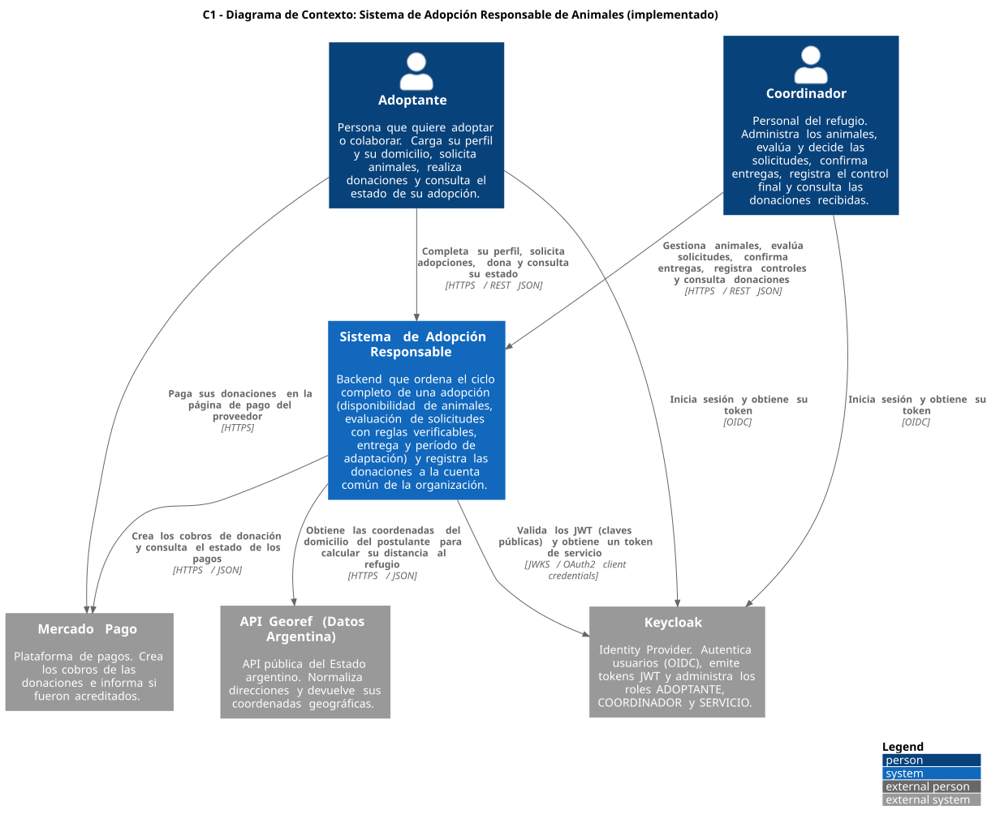
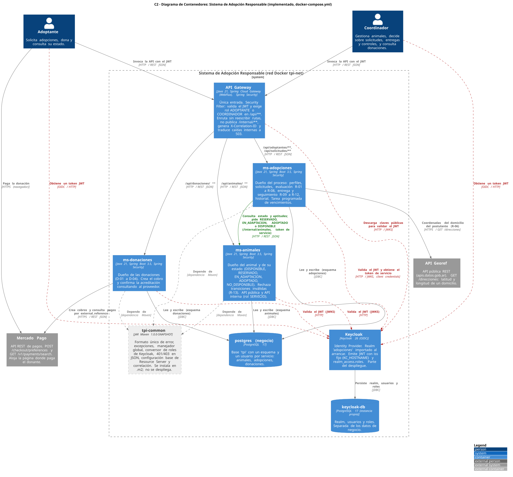

# Adopción Responsable — Backend de Microservicios

Sistema distribuido para coordinar el ciclo completo de adopción de animales y el registro de donaciones de un refugio, construido con Java 21, Spring Boot 3.5 y Spring Cloud.

[](https://github.com/GinoPiersigilli/Backend-Mascotas/actions/workflows/ci.yml)
[](https://adoptium.net/)
[](https://spring.io/projects/spring-boot)
[](LICENSE)

---

## 1. Qué es y qué problema resuelve

Muchos refugios de animales gestionan adopciones a través de chats y planillas sueltas: no existe una fuente única de verdad sobre qué animales están disponibles, varias personas se postulan por el mismo animal al mismo tiempo, las aprobaciones se toman sin validar compatibilidad del hogar ni distancia geográfica, no hay seguimiento formal durante el período de adaptación y las donaciones quedan desvinculadas de su estado real de cobro.

Este backend resuelve ese flujo aplicando reglas de negocio explícitas en cada transición de estado y registrando un historial auditable de cada decisión. Cubre cinco procesos: gestión del catálogo y ciclo de vida del animal (**P1**), presentación y evaluación de solicitudes con compatibilidad y distancia (**P2**), entrega dentro de un plazo con vencimiento automático (**P3**), seguimiento de adaptación y posibles devoluciones (**P4**), y cobro/confirmación de donaciones (**P5**).

Interactúa con tres sistemas externos reales: **Keycloak** para autenticación y autorización OIDC/JWT, la **API pública Georef** (Argentina) para geolocalizar domicilios y calcular distancia al refugio, y **Mercado Pago** (Checkout Pro) para gestionar donaciones.

> **Documentación técnica en [`docs/`](docs):** [análisis de dominio](docs/ANALISIS.md), [contratos de integración](docs/CONTRATOS.md), [referencia de API](docs/API.md), [decisiones arquitectónicas (ADR)](docs/ADR.md) y [patrones aplicados](docs/PATRONES.md).

---

## 2. Demo y Quickstart

<!-- TODO: agregar GIF o capturas del flujo completo de adopción (Postman / Swagger UI / logs con X-Correlation-ID) -->

Levantar el stack completo (7 contenedores: Gateway, 3 microservicios, Keycloak y 2 instancias PostgreSQL) y ejecutar la prueba de humo de punta a punta:

```bash
cp .env.example .env
docker compose up --build -d
./scripts/prueba-humo.sh
```

> Esperar a que `docker compose ps` muestre todos los contenedores en estado `healthy` (Keycloak tarda ~30–90 s en el primer arranque) antes de correr `./scripts/prueba-humo.sh`. En Windows puede ejecutarse con Git Bash (`bash ./scripts/prueba-humo.sh`).

---

## 3. Arquitectura

```text
Cliente / Postman ──► Keycloak :8180 (OIDC, emite JWT con realm_access.roles)
   │
   └─JWT─► API Gateway :8080 (Security Filter + rutas + X-Correlation-ID)
               ├─► ms-animales   :8081  catálogo y máquina de estados del animal
               ├─► ms-adopciones :8082  proceso de adopción ──► ms-animales /internal (token SERVICIO)
               │                                          └──► API Georef (HTTPS)
               └─► ms-donaciones :8083  donaciones        ──► Mercado Pago (HTTPS)
   PostgreSQL de negocio (esquemas animales | adopciones | donaciones, un usuario por esquema)
   PostgreSQL de Keycloak (instancia propia)
   tpi-common (JAR Maven): errores, excepciones, conversor de roles, correlación — usado por los 3 servicios
```

**¿Por qué microservicios?** Los dominios tienen dueños de datos, reglas y ritmos de cambio independientes: `ms-animales` protege la máquina de estados del animal (un animal existe sin solicitudes), `ms-adopciones` orquesta el flujo de evaluación, plazos e historial, y `ms-donaciones` aísla por completo la integración con el proveedor de pagos.

**¿Por qué un API Gateway?** Centraliza el único punto de entrada público (`:8080`), valida el JWT en el borde, impide la exposición de rutas internas (`/internal/**`), estandariza las respuestas de error cuando un servicio aguas abajo no responde (`503`) y propaga un `X-Correlation-ID` para trazar cada petición de punta a punta.

### Diagramas C4

Fuentes PlantUML: [C1 — Contexto](docs/diagramas/C1-Contexto.puml), [C2 — Contenedores](docs/diagramas/C2-Contenedores.puml) y [Secuencia de aprobación](docs/diagramas/Secuencia-aprobar.puml).

#### C1 — Diagrama de Contexto



#### C2 — Diagrama de Contenedores



### Módulos y tecnologías

| Módulo | Responsabilidad | Puerto |
|---|---|---|
| `tpi-common` | JAR compartido (no desplegable): `ErrorResponse`, excepciones de dominio, `GlobalExceptionHandler`, `KeycloakRoleConverter`, respuestas 401/403 en JSON, `ResourceServerDefaults`, filtro e interceptor de `X-Correlation-ID` | — |
| `ms-animales` | Dueño del catálogo y de la máquina de estados del animal; valida transiciones (R-13). Expone API pública y API interna | `8081` |
| `ms-adopciones` | Dueño del proceso de adopción: perfiles, solicitudes, evaluación (Georef), entrega, control final, historial y tarea programada de vencimientos | `8082` |
| `ms-donaciones` | Creación de preferencias de pago y confirmación consultando Mercado Pago | `8083` |
| `gateway` | Entrada única (Spring Cloud Gateway WebFlux), validación de JWT en el borde, enrutamiento, correlación y errores uniformes | `8080` |

| Tecnología | Versión | Notas |
|---|---|---|
| Java | 21 (`--release 21`) | Imágenes Docker basadas en Eclipse Temurin 21 |
| Spring Boot | 3.5.16 | MVC en microservicios; WebFlux en Gateway |
| Spring Cloud | 2025.0.3 | `spring-cloud-starter-gateway-server-webflux` |
| springdoc-openapi | 2.8.17 | Documentación OpenAPI 3 / Swagger UI por servicio |
| PostgreSQL | 17 (Alpine) | Instancias separadas para negocio y Keycloak |
| Keycloak | 26.8.1 | Realm importado automáticamente desde `infra/keycloak/realm-adopciones.json` |
| H2 | Gestionada por Boot | Modo PostgreSQL en pruebas automatizadas |

---

## 4. Decisiones técnicas destacadas

Las 14 decisiones arquitectónicas completas están documentadas en [docs/ADR.md](docs/ADR.md). Resumen de las principales:

| Decisión | Resumen | ADR |
|---|---|---|
| Seguridad en dos capas y token de servicio | El Gateway valida JWT y bloquea `/internal/**`; cada servicio vuelve a validar firma/roles/pertenencia. `ms-adopciones` usa `client_credentials` (rol `SERVICIO`) para llamar a `ms-animales` en lugar de reenviar el token del usuario | [ADR-04](docs/ADR.md#adr-04-seguridad-en-dos-capas-y-token-de-servicio-trusted-zone) |
| Emisor JWT fijo (`KC_HOSTNAME`) | Fija `iss=http://localhost:8180/realms/adopciones` para tokens pedidos desde el host o la red interna, descargando JWKS por `http://keycloak:8080/.../certs` sin *discovery* bloqueante al arrancar | [ADR-05](docs/ADR.md#adr-05-emisor-del-token-fijo-con-kc_hostname) |
| Consistencia sin transacción distribuida | Persiste y hace `flush` del cambio local antes de invocar a `ms-animales`; si la llamada remota falla, la transacción local hace *rollback*. El caso residual queda registrado en logs | [ADR-06](docs/ADR.md#adr-06-consistencia-entre-servicios-sin-transacción-distribuida) |
| Concurrencia sin bloqueos pesimistas | Columnas de bloqueo (`animal_pendiente`, `adoptante_activo`) con `UNIQUE` compatibles con PostgreSQL/H2, combinadas con bloqueo optimista (`@Version`) | [ADR-07](docs/ADR.md#adr-07-concurrencia-columnas-de-bloqueo-con-unique--bloqueo-optimista) |
| Esquema y usuario por servicio | Una sola instancia PostgreSQL de negocio con esquemas y credenciales aisladas (`animales`, `adopciones`, `donaciones`) y base aparte para Keycloak | [ADR-08](docs/ADR.md#adr-08-persistencia-una-instancia-esquema-y-usuario-por-servicio-keycloak-aparte) |
| Sin Lombok; `record` para DTOs | DTOs y propiedades como `record` de Java 21; entidades con métodos de dominio explícitos en lugar de *setters* abiertos | [ADR-12](docs/ADR.md#adr-12-sin-lombok-records-para-dto) |

---

## 5. Reglas de negocio y dónde están implementadas

| Regla | Descripción resumida | Implementación | Pruebas |
|---|---|---|---|
| **R-01** | Animal disponible y sin otra solicitud `PENDIENTE` | `SolicitudService.crear`, columnas `UNIQUE` en `Solicitud` | `FlujoAdopcionIntegrationTest.r01*`, `SolicitudRepositoryTest` |
| **R-02** | Máximo una solicitud activa por adoptante | `SolicitudService.crear`, columna `adoptante_activo` | `r02*`, `SolicitudRepositoryTest` |
| **R-03** | Perfil del adoptante completo antes de solicitar | `SolicitudService.crear`, `PerfilRequest` | `r03SinPerfilNoSePuedeSolicitar` |
| **R-04** | Incompatibilidad dura (niños / otros animales) → `RECHAZADA` con traza | `EvaluadorSolicitud.incompatibilidadDura` | `EvaluadorSolicitudTest`, `r04*` |
| **R-05** | Requiere espacio exterior sin patio → observación | `EvaluadorSolicitud.observacionesDeCompatibilidad` | `EvaluadorSolicitudTest.r05*` |
| **R-06** | Cálculo de distancia con Georef (fallback no bloqueante si falla) | `EvaluadorSolicitud.evaluarDistancia`, `GeorefClient`, `CalculadoraDistancia` | `EvaluadorSolicitudTest.r06*`, `GeorefClientTest` |
| **R-07** | Aprobar solo en `PENDIENTE` y reservando en `ms-animales` | `Solicitud.aprobar` + `AnimalesClient.cambiarEstado(RESERVADO)` | `r07*`, `siAnimalesNoResponde*` |
| **R-08** | Motivo obligatorio en rechazo y justificación ante excepción | `Solicitud.verificarAprobable`, `SolicitudRequests.Motivo` | `SolicitudTest.r08*`, `r06YR08*` |
| **R-09** | Entrega dentro del plazo (con cancelación automática al vencer) | `Solicitud.plazoEntregaVencido`, `TareaVencimientos` | `r09*` |
| **R-10** | Confirmación de entrega fija fecha de control final | `Solicitud.confirmarEntrega` | `SolicitudTest.r10*` |
| **R-11** | Control final habilitado recién desde la fecha pactada | `Solicitud.registrarControl` | `SolicitudTest.r11*`, flujo completo |
| **R-12** | Control desfavorable o devolución → `REVERTIDA` y animal `DISPONIBLE` | `Solicitud.registrarControl`, `Solicitud.devolver` | `r12*` |
| **R-13** | Un animal con adopción en curso no puede marcarse `NO_DISPONIBLE` | `Animal.marcarNoDisponible` | `AnimalTest.r13*` |
| **D-01 a D-04** | Monto mínimo, confirmación vía Mercado Pago, idempotencia por pago y pertenencia | `DonacionService`, `Donacion`, `SecurityConfig` de donaciones | `FlujoDonacionIntegrationTest` |

---

## 6. Seguridad, persistencia, ejecución, pruebas y cobertura

### Seguridad

- **Autenticación OIDC:** Los usuarios obtienen su JWT de Keycloak mediante el cliente público `tpi-client`. Ningún servicio maneja contraseñas.
- **Defensa en profundidad:** El Gateway valida firma, emisor y expiración, restringiendo `/api/**` a roles `ADOPTANTE` o `COORDINADOR` y bloqueando `/internal/**`. Cada microservicio revalida el JWT y aplica autorización fina por rol y pertenencia del recurso (`403` si el recurso pertenece a otro usuario).
- **Comunicación servicio-a-servicio:** `ms-adopciones` obtiene su propio token con `client_credentials` (cliente confidencial `adopciones-service`, rol `SERVICIO`) para operar contra `/internal/animales/**`.

| Rol / Acceso | Alcance permitido |
|---|---|
| Sin token | `/actuator/health` (y Swagger UI directo en cada servicio si `SWAGGER_ENABLED=true`) |
| `ADOPTANTE` | Su perfil; crear, consultar y cancelar sus solicitudes; pedir devolución; consultar animales; donar y consultar sus donaciones |
| `COORDINADOR` | Administrar animales; listar y decidir solicitudes; consultar perfiles de postulantes; confirmar entrega y control final; consultar todas las donaciones y el total confirmado |
| `SERVICIO` | Exclusivamente `/internal/animales/**` y lectura interna de métricas (`GET /actuator/prometheus`) |

### Observabilidad y métricas

- Cada microservicio (`ms-animales`, `ms-adopciones`, `ms-donaciones`) incorpora `micrometer-registry-prometheus` y expone `GET /actuator/prometheus` únicamente dentro de la red interna `tpi-net` (el API Gateway no expone ni enruta `/actuator/prometheus`, manteniendo solo `health` e `info`).
- Coherente con la defensa en profundidad de [ADR-04](docs/ADR.md#adr-04-seguridad-en-dos-capas-y-token-de-servicio-trusted-zone), `GET /actuator/prometheus` exige un JWT válido de Keycloak con rol `SERVICIO` (`401` sin token, `403` para roles de usuario `ADOPTANTE` o `COORDINADOR`). Todas las series incluyen la etiqueta común `application` (`ms-animales`, `ms-adopciones`, `ms-donaciones`).
- **Métricas de negocio en `ms-adopciones`:**
  - `adopciones_solicitudes_creadas_total` (`adopciones.solicitudes.creadas`): contador de solicitudes de adopción creadas correctamente.
  - `adopciones_solicitudes_aprobadas_total` (`adopciones.solicitudes.aprobadas`): contador de solicitudes aprobadas tras confirmar la reserva en `ms-animales`.
- No se incluye un servidor Prometheus/Grafana en `docker-compose.yml` para mantener liviano el stack local; un scraper externo en `tpi-net` (o `curl` en desarrollo usando `docker-compose.override.yml`) solo necesita un token `client_credentials` con rol `SERVICIO` en `Authorization: Bearer <token>`.

### Persistencia

- Una instancia PostgreSQL 17 para negocio con un esquema y un usuario dueño por servicio ([infra/postgres/init/01-esquemas.sh](infra/postgres/init/01-esquemas.sh)): ningún servicio tiene permisos sobre las tablas de otro.
- Esquemas versionados con **Flyway** (`src/main/resources/db/migration/V1__esquema_inicial.sql` en cada servicio) y Hibernate configurado con `ddl-auto: validate`.
- Instancia PostgreSQL dedicada para Keycloak (`keycloak-db`).
- Volúmenes nombrados (`tpi-postgres-data`, `tpi-keycloak-db-data`) para preservar datos entre reinicios.

### Ejecución detallada

**Requisitos:** JDK 21+, Maven 3.9+, Docker con Compose v2 y acceso a Internet (descarga de imágenes/dependencias, Georef y Mercado Pago).

1. **Configurar variables de entorno:**
   ```bash
   cp .env.example .env
   ```
   Ajustar las contraseñas en `.env` (`ADOPCIONES_SERVICE_CLIENT_SECRET`, `DEMO_USERS_PASSWORD`, credenciales de PostgreSQL/Keycloak) y, para probar donaciones reales contra sandbox, completar `MP_ACCESS_TOKEN` con el token de una cuenta vendedora de prueba de Mercado Pago. Por defecto `PERIODO_ADAPTACION_DIAS=0` permite recorrer el flujo completo sin esperar (en operación normal usar `30`).

2. **Levantar con Docker Compose:**
   ```bash
   # Desarrollo (publica Gateway :8080, Keycloak :8180, servicios :8081-:8083, Postgres :5433 y activa Swagger UI)
   docker compose up --build -d

   # Verificar estado (esperar healthy en los 7 contenedores)
   docker compose ps

   # Modo restringido (solo publica Gateway :8080 y Keycloak :8180; Swagger deshabilitado por defecto)
   docker compose -f docker-compose.yml up --build -d
   ```

3. **Operación y pruebas manuales:**
   ```bash
   # Prueba de humo end-to-end a través del Gateway
   ./scripts/prueba-humo.sh

   # Logs con formato [servicio] [X-Correlation-ID]
   docker compose logs -f ms-adopciones

   # Detener conservando volúmenes / reinicio limpio (reimporta el realm y los esquemas)
   docker compose down
   docker compose down -v
   ```
   También se incluye la colección [postman/TPI-Adopciones.postman_collection.json](postman/TPI-Adopciones.postman_collection.json) y el entorno [postman/TPI-local.postman_environment.json](postman/TPI-local.postman_environment.json) (completar `demoPassword`).

4. **Ejecución local sin Docker (para desarrollo):**
   Con `postgres` (`localhost:5433`) y `keycloak` (`localhost:8180`) activos, compilar e instalar `tpi-common` con `mvn clean install` y levantar cada servicio con `mvn -pl <modulo> spring-boot:run`.

5. **Documentación OpenAPI / Swagger UI (habilitada solo en desarrollo vía `docker-compose.override.yml`, `SWAGGER_ENABLED=false` por defecto en `docker-compose.yml`):**
   `http://localhost:8081/swagger-ui.html`, `http://localhost:8082/swagger-ui.html` y `http://localhost:8083/swagger-ui.html`.

### Pruebas y cobertura

Las pruebas automatizadas no requieren Docker, Keycloak ni acceso a Internet: usan H2 en modo PostgreSQL, `MockRestServiceServer` para contratos HTTP externos, `@MockitoBean` en flujos de integración, `Clock` inyectable para vencimientos y `jwt()`/`mockJwt()` de Spring Security Test.

```bash
# Compila el reactor una sola vez, ejecuta la suite sin Docker y genera reportes JaCoCo
mvn -B clean verify

# Ejecuta además las pruebas de integración con Testcontainers (PostgreSQL 17 + Flyway + ddl-auto: validate, requiere Docker)
mvn -B verify -Pintegration-tests
```

| Módulo | Cobertura de pruebas |
|---|---|
| `tpi-common` | Conversor de roles de Keycloak, `GlobalExceptionHandler`, filtro de `X-Correlation-ID` |
| `ms-animales` | Máquina de estados y R-13, repositorio JPA (H2), matriz de permisos, carga de datos demo |
| `ms-adopciones` | Agregado `Solicitud` (R-07..R-12), `EvaluadorSolicitud` (R-04..R-06), Haversine, clientes HTTP (`AnimalesClient`, `GeorefClient`, `ServiceTokenProvider`), unicidad `UNIQUE`, flujo end-to-end por HTTP con seguridad, tolerancia a fallas y vencimientos con reloj controlado |
| `ms-donaciones` | `MercadoPagoClient` (contratos y fallas), flujo completo D-01..D-04 |
| `gateway` | 401/403, bloqueo de `/internal/**`, servicio caído → `503`, correlación y `404` |

Los tests de integración con Testcontainers (`*IT.java`, etiquetados `@Tag("integration")`) se excluyen por defecto para que `mvn clean test` y `mvn verify` corran sin Docker, y se activan mediante el perfil Maven `-Pintegration-tests` (`maven-failsafe-plugin`).

Los reportes de cobertura de **JaCoCo** se generan localmente en `<módulo>/target/site/jacoco/index.html` y se publican automáticamente como artifact (`jacoco-reports`) en cada ejecución del workflow de GitHub Actions ([.github/workflows/ci.yml](.github/workflows/ci.yml)).

---

## 7. Limitaciones conocidas y próximos pasos

### Limitaciones actuales
- **Cálculo de distancia:** se calcula en línea recta (Haversine) y no por distancia vial real.
- **Sin webhooks de Mercado Pago:** al ejecutarse en entorno local sin HTTPS público, el estado de una donación se sincroniza por consulta (*polling* bajo demanda) en lugar de notificaciones *push*.
- **Consistencia entre servicios:** no hay patrón Outbox ni reconciliación automática; si `ms-animales` confirma una reserva y el *commit* local de `ms-adopciones` falla inmediatamente después, requiere intervención manual ([ADR-06](docs/ADR.md#adr-06-consistencia-entre-servicios-sin-transacción-distribuida)).
- **Configuración de Keycloak local:** se utiliza `start-dev` (HTTP sin TLS) y *Resource Owner Password Grant* en `tpi-client` para facilitar pruebas locales y desde Postman.
- **Seguimiento de vencimientos:** la tarea programada automatiza R-09 (entrega vencida); los controles finales vencidos (R-11) se consultan filtrando solicitudes `EN_ADAPTACION` por `fechaControl`.

### Próximos pasos
- Implementar un **Outbox transaccional** o una tarea de reconciliación periódica para cubrir el caso residual de [ADR-06](docs/ADR.md#adr-06-consistencia-entre-servicios-sin-transacción-distribuida).
- Añadir un endpoint de **webhook de Mercado Pago** con verificación de firma sobre HTTPS.
- Migrar la autenticación de usuarios a **Authorization Code + PKCE** cuando se integre un frontend, deshabilitando *password grant* y usando Keycloak en modo producción detrás de TLS.
- Sumar trazas distribuidas (**OpenTelemetry**) sobre el `X-Correlation-ID` existente y conectar un stack de scraping/dashboards (**Prometheus + Grafana**) sobre los endpoints `/actuator/prometheus` ya expuestos.

<!-- TODO: agregar enlace a despliegue en vivo o colección pública si se publica en cloud -->

---

## 8. Licencia

Distribuido bajo licencia **MIT**. Ver [LICENSE](LICENSE) para más detalles.
