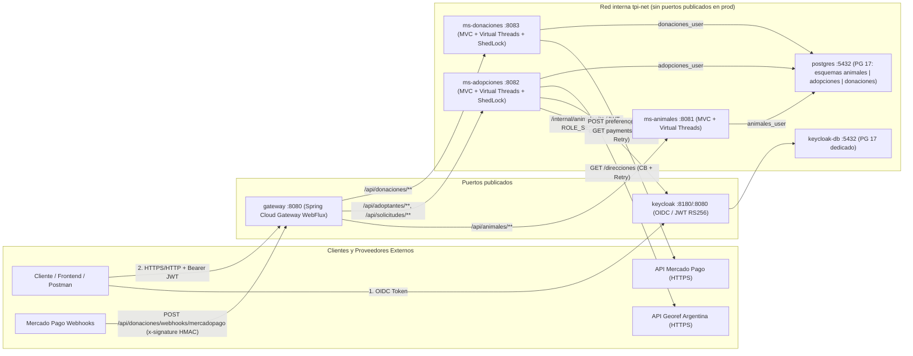
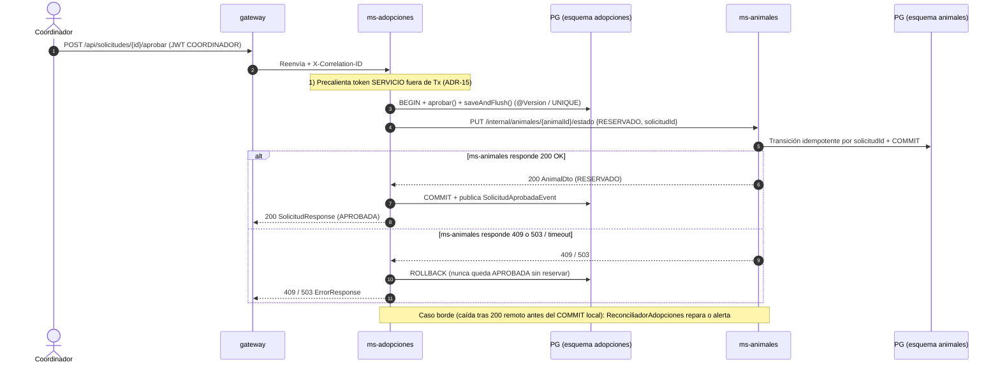
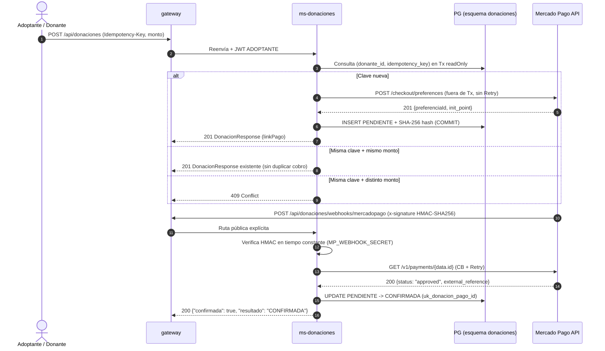
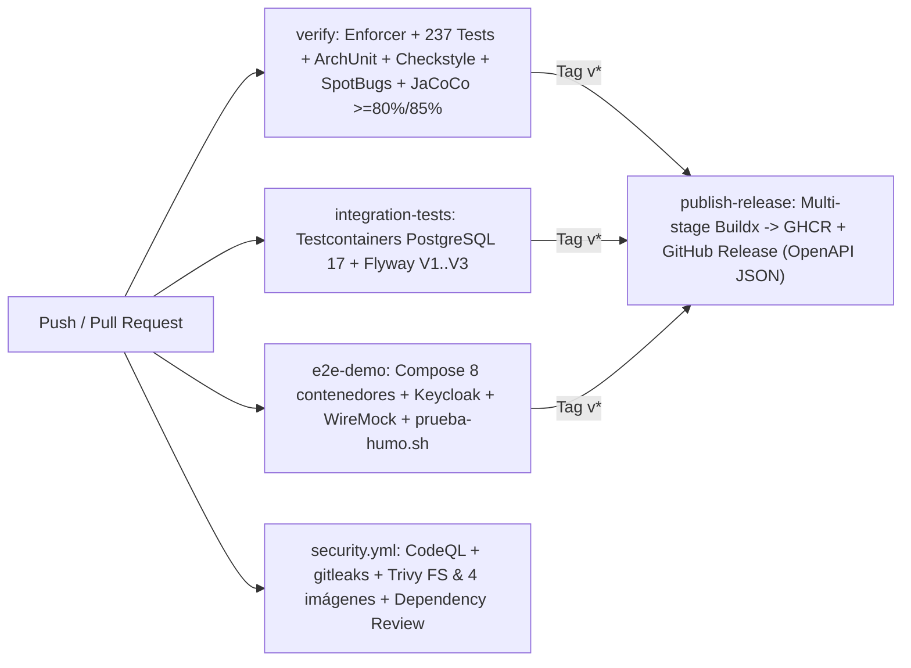

# Arquitectura del Sistema

Documento de referencia sobre la topología de contenedores, fronteras de confianza, modelo de consistencia entre servicios, persistencia aislada y pipeline de verificación continua.

---

## 1. Topología de contenedores y fronteras de red

En el perfil productivo base (`docker-compose.yml`), **únicamente el API Gateway (`:8080`) y Keycloak (`:8180`) publican puertos al host**. Los tres microservicios de dominio y las dos instancias PostgreSQL operan aislados dentro de la red interna `tpi-net`.

> Diagramas C4 originales en PlantUML / SVG también disponibles en [`docs/diagramas/`](diagramas/).

---

## 2. Responsabilidades por módulo Maven

| Módulo | Stack | Rol arquitectónico |
|---|---|---|
| `gateway` | WebFlux + Netty + OAuth2 Resource Server reactivo | Autenticación JWT en el borde (`iss`, `exp` skew 30 s, allowlist `azp`), CORS cerrado por defecto, cabeceras de seguridad, límite de cuerpo (`413`), generación/sanitización de `X-Correlation-ID` y ocultamiento de `/internal/**` y `/actuator/prometheus`. No depende de `tpi-common` (ADR-09). |
| `tpi-common` | Librería JAR (`provided` deps) | Contrato unificado `ErrorResponse`, `GlobalExceptionHandler`, manejadores JSON `401`/`403`, `KeycloakRoleConverter`, `JwtTokenValidators`, `ResourceServerDefaults` y propagación de `X-Correlation-ID` en `Servlet` y `RestClient`. |
| `ms-animales` | Spring MVC + JPA + Flyway | Único dueño del catálogo y de la máquina de estados `EstadoAnimal` (`R-13`). Expone API pública (`/api/animales/**`) e interna idempotente (`/internal/animales/**`, restringida a `ROLE_SERVICIO`). |
| `ms-adopciones` | Spring MVC + JPA + Flyway + Resilience4j + ShedLock | Orquesta perfiles, evaluación automática (`R-01..R-06` con Georef + Haversine), aprobación/entrega/control/devolución (`R-07..R-12`), eventos en proceso post-commit, reportes y tareas distribuidas (vencimientos, alertas de control y reconciliación con `ms-animales`). |
| `ms-donaciones` | Spring MVC + JPA + Flyway + Resilience4j + ShedLock | Gestiona donaciones (`D-01..D-04`) con `Idempotency-Key` SHA-256, creación de preferencias Checkout Pro y triple vía idempotente de confirmación (webhook firmado HMAC-SHA256, reconciliación periódica y consulta bajo demanda). |
| `coverage-report` | Módulo POM agregador | Consolida la cobertura multi-módulo (`jacoco:report-aggregate`) durante `verify`. |

---

## 3. Consistencia entre servicios sin transacciones distribuidas (P2–P4)

Al no existir 2PC sobre HTTP ni un broker externo, las transiciones que modifican tanto `Solicitud` (`ms-adopciones`) como `Animal` (`ms-animales`) combinan **orden local-primero con rollback**, **idempotencia por `solicitudId`** y **reconciliación periódica/manual** (ADR-06, ADR-15, ADR-20, ADR-21):

---

## 4. Flujo idempotente de donaciones y webhook firmado (P5)

---

## 5. Aislamiento de datos y control de concurrencia

- **Aislamiento por esquema y rol de base de datos:** el script `infra/postgres/init/01-esquemas.sh` revoca privilegios cruzados; cada microservicio solo puede leer y migrar su propio esquema (`animales`, `adopciones`, `donaciones`) con `Flyway` + `ddl-auto: validate`.
- **Invariantes concurrentes en PostgreSQL:**
  - `adopciones.solicitud`: `uk_solicitud_animal_pendiente` (`R-01`), `uk_solicitud_adoptante_activo` (`R-02`) y `@Version` optimista (`SolicitudConcurrenciaTest` demuestra `1×200 + 1×409` ante dos aprobaciones simultáneas).
  - `donaciones.donacion`: `uk_donacion_pago_id` (`D-03`) y `uk_donacion_donante_idempotency_key` (`ADR-18`).
  - `adopciones.shedlock` y `donaciones.shedlock`: exclusión mutua entre réplicas para tareas `@Scheduled`.
- **Eficiencia de consultas:** `spring.jpa.open-in-view: false`, `@BatchSize(size = 50)` y paginación SQL real (`LIMIT`/`OFFSET` + `X-Total-Count`), respaldada por índices medidos con 10.000 filas en [`docs/rendimiento.md`](rendimiento.md).

---

## 6. Pipeline de calidad, seguridad y entrega continua

